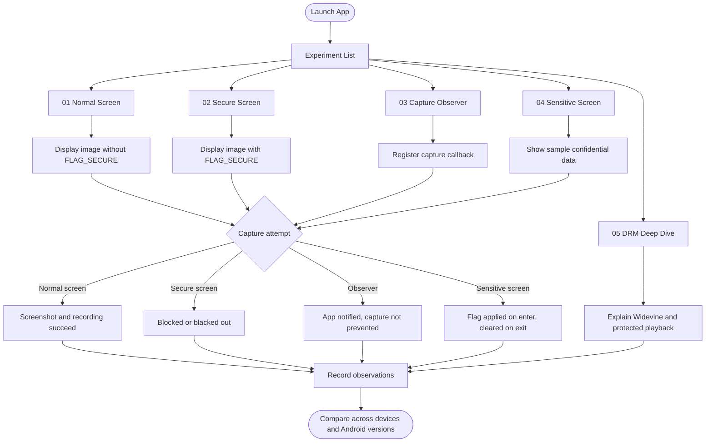

# Secure Screen Lab

> Explore how Android protects sensitive content from screenshots, screen recording, and unauthorized capture.

Secure Screen Lab is an experimental Android application built with **Kotlin** to explore Android's screen capture security mechanisms through practical, reproducible experiments.

Inspired by the screenshot restrictions found in streaming platforms like Netflix, this project demonstrates how Android developers can protect sensitive UI content, observe platform behaviour, and understand the limitations of client-side screen security.

The goal is simple: **don't just learn Android security. Build it, test it, and understand what actually happens.**

## What You'll Explore

- **Screenshot Protection:** Experiment with Android's `FLAG_SECURE` window flag.
- **Screen Recording:** Compare recording behaviour between protected and unprotected screens.
- **Recent App Previews:** Investigate how secure windows affect app-switcher previews.
- **Sensitive UI:** Build screens that display content requiring additional protection.
- **Capture Detection:** Explore Android's screen-capture callbacks where supported.
- **Device Differences:** Compare results across Android versions and manufacturers.
- **Media Protection:** Learn how DRM systems such as Widevine differ from ordinary screenshot prevention.
- **Security Limitations:** Understand what Android's protections can and cannot guarantee.

## App Flow



## Experiments

### 01. The Normal Screen

Display an image without screenshot protection.

**Investigate:**

- Can the image be captured?
- What appears in a screenshot?
- Does screen recording behave differently?

### 02. The Secure Screen

Display the same image with `FLAG_SECURE` enabled.

**Investigate:**

- What happens when you take a screenshot?
- What appears in the recent-apps screen?
- Does the result vary by device?

### 03. The Capture Observer

Explore supported Android APIs for observing screen capture events.

**Investigate:**

- When does the operating system notify the app?
- What can the app learn about a capture?
- Why is capture notification different from capture prevention?

### 04. The Sensitive Screen

Create a screen containing sample confidential information and apply appropriate window protection.

**Investigate:**

- How should an app protect sensitive UI?
- What happens when navigating between protected and unprotected screens?
- How should protection be applied and removed safely?

### 05. The DRM Deep Dive

Explore the difference between protecting a window and protecting licensed video playback.

**Investigate:**

- What is Widevine DRM?
- What are secure video decoding and protected playback paths?
- Why can't `FLAG_SECURE` replace a complete DRM system?

## Tech Stack

- **Language:** Kotlin
- **Platform:** Android
- **UI:** Android Views or Jetpack Compose
- **Build System:** Gradle
- **Security API:** Android `WindowManager`
- **Minimum SDK:** To be determined based on the experiments and APIs included

## Getting Started

### Prerequisites

- Android Studio
- A compatible Android SDK
- JDK compatible with the project's Gradle configuration
- An Android device or emulator

### Run the project

1. Clone the repository.

   ```bash
   git clone https://github.com/GDGOAU-MOBILE/secure-screen-lab.git
   cd secure-screen-lab
   ```

2. Open the project in Android Studio.
3. Allow Gradle to sync and download the required dependencies.
4. Run the application on an Android device or emulator.
5. Open an experiment and compare the results.

## How It Works

Android provides a window-level security mechanism that can restrict screenshots and screen recording of protected content.

```kotlin
window.setFlags(
    WindowManager.LayoutParams.FLAG_SECURE,
    WindowManager.LayoutParams.FLAG_SECURE
)
```

To remove the flag from a test screen:

```kotlin
window.clearFlags(
    WindowManager.LayoutParams.FLAG_SECURE
)
```

These examples demonstrate the core mechanism. The application will explore how it behaves in different capture scenarios and Android environments.

## Important Security Notes

Secure Screen Lab is an educational project, **not a DRM implementation**.

- `FLAG_SECURE` is a useful platform control, not a guarantee against every method of capturing displayed content.
- Behaviour can vary across Android versions, manufacturers, and capture mechanisms.
- Capture detection and capture prevention are separate capabilities.
- Widevine and similar DRM systems involve additional media-protection mechanisms.
- Experiments should be conducted on your own devices and applications, with permission.

## Contributing

Contributions are welcome.

You can contribute by:

- Adding a new experiment.
- Testing behaviour on another Android version.
- Documenting differences between devices.
- Improving the Kotlin implementation.
- Writing tests and reproducible experiment reports.
- Explaining an Android security API with a working example.

For each experiment, include the Android version, device or emulator details, expected behaviour, observed behaviour, and any relevant limitations.

Please open an issue before making large architectural changes.

## Learning Resources

- [Android Developers](https://developer.android.com/)
- [Android Security Best Practices](https://developer.android.com/privacy-and-security/security-best-practices)
- [WindowManager.LayoutParams](https://developer.android.com/reference/android/view/WindowManager.LayoutParams)
- [Widevine DRM](https://developers.google.com/widevine/drm/overview)

## License

This project is licensed under the [MIT License](LICENSE).

---

Built by **GDG OAU Mobile**.
